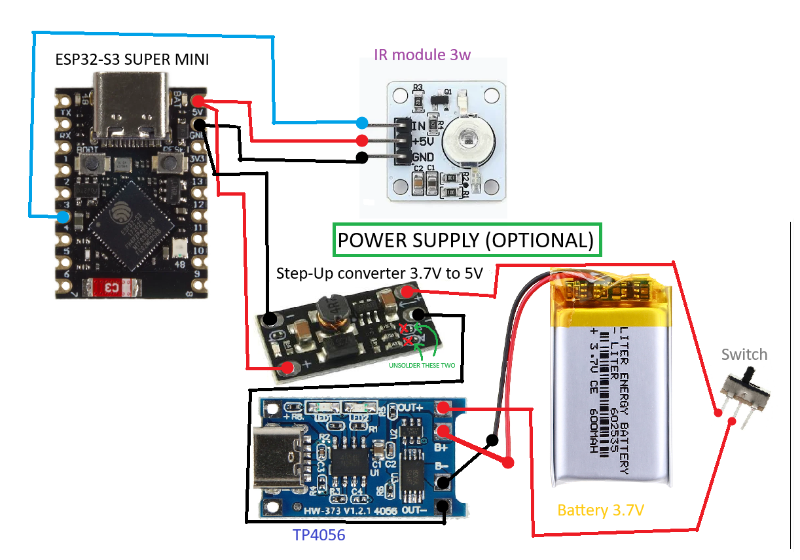

# TV-B-Gone (ESP32-S3)

A tiny battery-powered TV-B-Gone. Flip the power switch, hold it pointed at a
room, and for about six seconds it fires every IR "power off" code I could find
at TVs and projectors around you. Then it goes to sleep until you cut the power
and flip it back on.

No buttons, no screen, no SD card — just an ESP32-S3 SuperMini, a 940 nm IR LED,
a battery, and a switch.

Based on [Bruce's TV-B-Gone](https://github.com/btaylor1/TV-B-GONE) with code
from the [ir_esphack](https://github.com/kevinmcaleer/infrared) project too.

## What it does

On power-up it blasts, in order:

1. EU power-off codes (~142) — I'm in Europe so these come first.
2. Universal parsed codes (50) — Samsung, LG, NEC, RCA, Pioneer, plus a couple of projector variants.
3. Universal raw codes (13) — generic "most TVs", Xiaomi and other raw bursts.

Each code is followed by the same ~20 ms pause Bruce uses, so the whole thing
takes about 5–7 seconds. Projectors are covered in the same pass so there's one
mode for everything. The North-America set from the database isn't sent — it'd
only add a few seconds of nothing here.

Once the blast is done `loop()` calls `esp_deep_sleep_start()`, current draw
drops to near zero, and the battery just sits until you cycle the power again.
No infinite loop.

## Hardware

| Part | Notes |
|------|-------|
| [ESP32-S3 SuperMini](https://www.espressif.com/en/products/modules/esp32-s3) | Main board |
| 940 nm high-power IR LED module (1 W / 3 W), 3-pin: 5V / GND / Signal | The emitter |
| Battery + on/off switch | Powers everything; the switch is your button |

Wiring:



```
ESP32-S3 SuperMini        IR LED module
  5V  (VIN)      <------->  5V
  GND            <-------->  GND
  GPIO4 / D4     <-------->  Signal (IN)
```

That's the whole circuit. Three wires to the emitter, plus a battery and switch
on the power rail — the SuperMini's regulator handles the 5 V for the LED, so
no separate supply needed. If you go with a 3 W module, keep an eye on the cell
size; the burst is short so it should be fine.

## Why no screen / button / SD card?

Because that's the point — minimal and one-shot:

- **No button** — the power switch does the job.
- **No display** — while transmitting, the IR LED gives off a faint glow you can
  see with your phone camera (or just feel it warm). When it goes dark you're done.
  If you want an explicit status light, any spare GPIO will do.
- **No SD card** — the code database is in flash and there's nothing to log, so
  removable storage would only add bulk.

## Repository layout

```
topiaryTVBGONE/
├─ README.md
├─ .gitignore
├─ docs/
│  └─ schematic.svg     # wiring diagram (renders on GitHub)
└─ firmware/            # PlatformIO project
   ├─ platformio.ini
   ├─ LICENSE
   └─ src/
      ├─ main.cpp       # the one-shot blast + deep sleep
      └─ WORLD_IR_CODES.h  # IR code database (~150 KB)
```

Build artifacts under `firmware/.pio` and generated VS Code files are gitignored.

## Build & flash

You'll need [PlatformIO](https://platformio.org/) (CLI, or the VS Code extension).
The only dependency — `IRremoteESP8266` — is pulled from the registry on first build.

```bash
cd firmware
pio run -t upload     # compile + flash
# or if pio isn't on PATH:
python -m platformio run --disable-auto-clean    # just compile
python -m platformio run -t upload               # compile + flash
```

The target env is `[env:esp32-s3-SuperMini]` using the `esp32-s3-devkitc-1` board
(pin-compatible). The IR signal goes to **GPIO4 (D4)** — change `GPIO_IR` in
[firmware/src/main.cpp](firmware/src/main.cpp) if you wire it somewhere else.

To use: flip the battery switch on, point at your targets, wait ~6 seconds, done.
Flip off/on to run again.

## Tuning

- **How long it runs** = number of codes × (code time + gap). Add or remove
  entries in [firmware/src/WORLD_IR_CODES.h](firmware/src/WORLD_IR_CODES.h), or
  change the order/count in `runAll()` in main.cpp.
- **Gap between codes**: `CODE_GAP_US` (20500 µs). Smaller = faster but less
  margin for slow IR receivers.
- Parsed codes carry their own carrier frequency; raw codes use stored timings
  directly — same decode path as Bruce (`read_bits(bitcompression) * 2` indexes
  into `times[]`, values ×10 → µs, sent via `irsend.sendRaw(...)`).

## License

MIT (see [firmware/LICENSE](firmware/LICENSE)). The IR code database is adapted
from public TV-B-Gone projects — see the originals for their terms.
